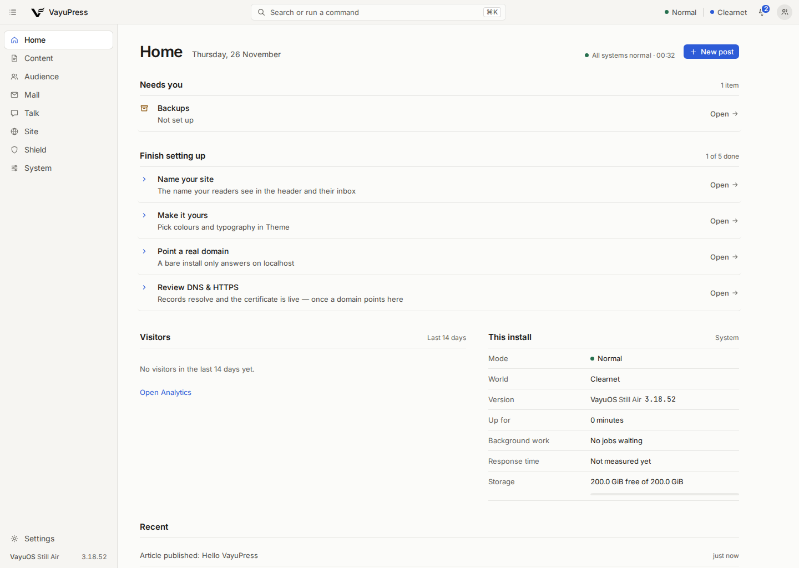
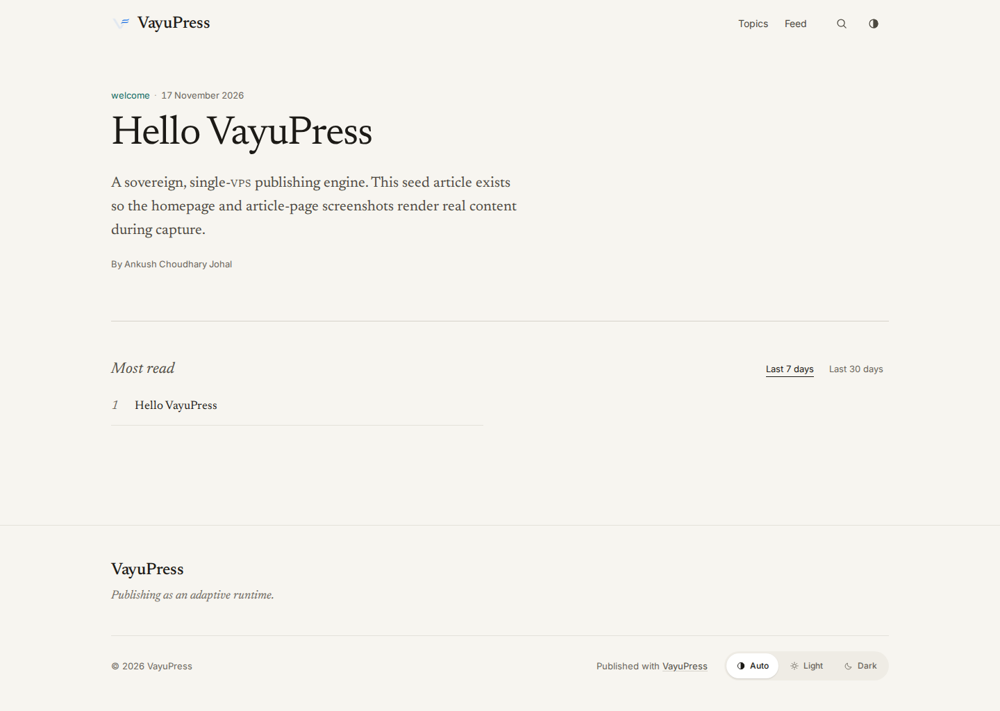
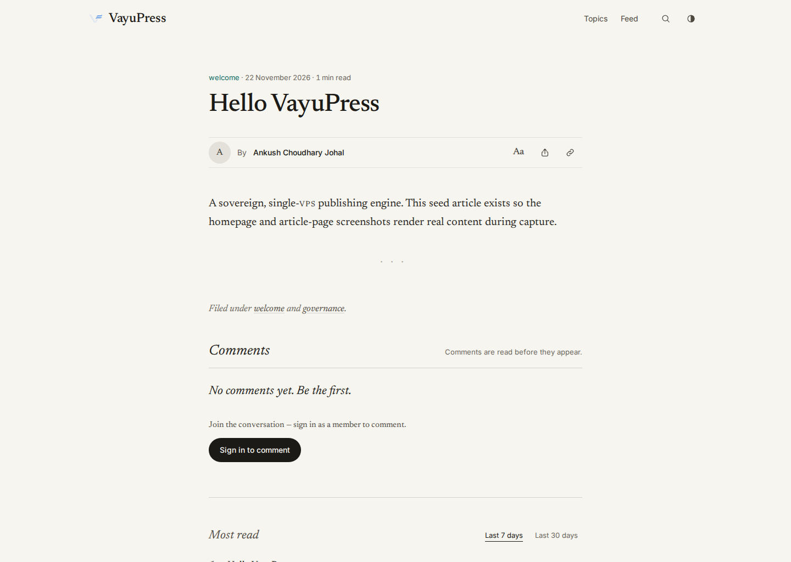
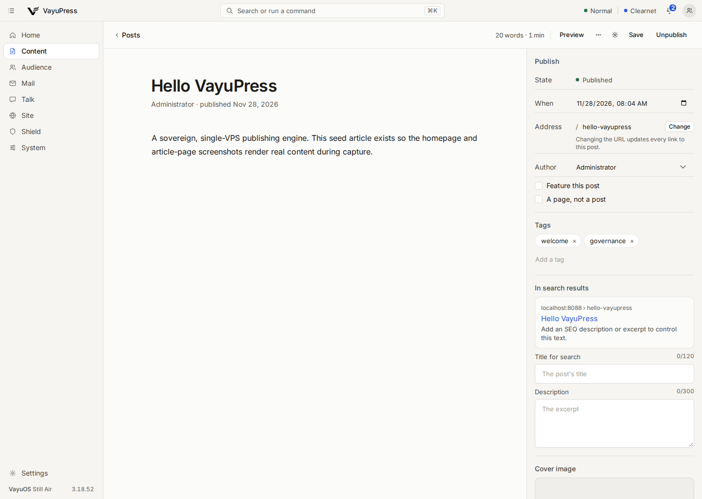
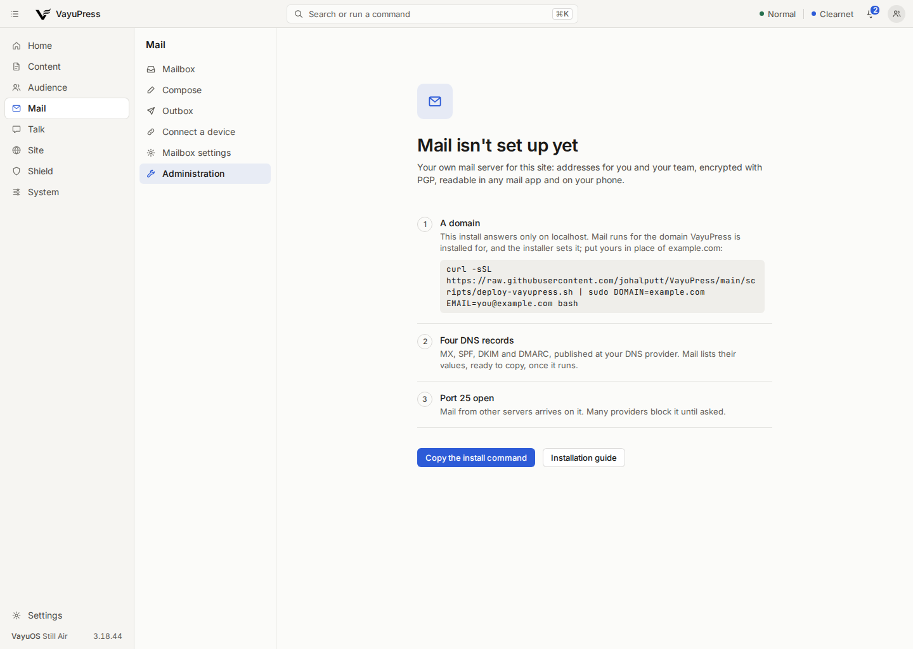
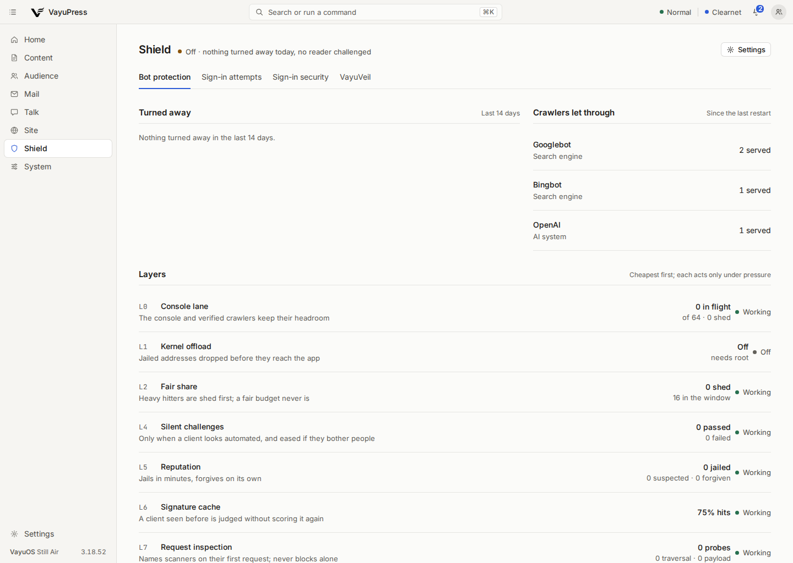
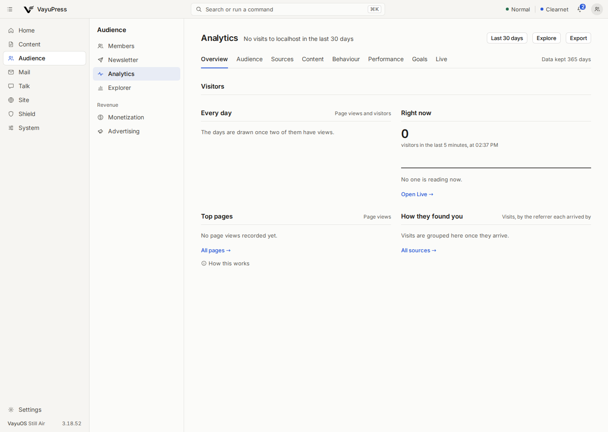

<p align="center">
  <picture>
    <source media="(prefers-color-scheme: dark)"  srcset="docs/assets/vayupress-mark-dark.png">
    <source media="(prefers-color-scheme: light)" srcset="docs/assets/vayupress-mark-light.png">
    
  </picture>
</p>

<h1 align="center">VayuPress</h1>

<p align="center">
  <strong>Your website, blog, mail, calendar, files and encrypted chat, self-hosted in one Go binary.</strong><br>
  One server, one SQLite database, one console. No telemetry, no SaaS, no tracking of your readers.
</p>

<p align="center">
  <a href="https://github.com/johalputt/vayupress/actions/workflows/ci.yml"></a>
  <a href="https://github.com/johalputt/vayupress/actions/workflows/security.yml"></a>
  <a href="https://github.com/johalputt/vayupress/actions/workflows/dep-freshness.yml"></a>
  <a href="https://github.com/johalputt/vayupress/releases/latest"></a>
  <a href="https://github.com/johalputt/vayupress/stargazers"></a>
  <a href="go.mod"></a>
  <a href="LICENSE"></a>
  
</p>

<p align="center">
  
</p>

## What VayuPress is

**VayuPress** is a self-hosted publishing and communication platform. You
point a domain at one server, run one install command, and get a website, a
blog, a mail server for your domain with a calendar and file storage beside
it, and end-to-end-encrypted chat, each with its certificate issued and
renewed for you.

You run all of it from **VayuOS**, its console at `/os`, where each part is
an app with its own section. Your content, mailboxes and data stay on your
server, in one SQLite file you can back up and move.

**See it running:** [johal.in](https://johal.in) is a live install with
235,102 posts and 14 sites, plus its own mail server, on one small VPS
([figures below](#a-live-install--johalin)).

## What it looks like

| | |
|---|---|
|  |  |
| *A blog's home, in Halcyon* | *An article: no third-party request* |
|  |  |
| *The block editor* | *VayuMail* |
|  |  |
| *VayuShield* | *VayuAnalytics* |

The screenshots are retaken from a fresh install by the
[screenshots workflow](.github/workflows/screenshots.yml) every two hours.

## Why VayuPress

Self-hosting the usual way means a mail server, a CMS, an analytics tool, a
bot filter and a chat service, each with its own database, proxy block,
certificate and upgrade path. VayuPress is all of them in one process that
installs, upgrades and backs up as one.

- **One thing to run.** One binary, one database file, one console and one
  upgrade, instead of five to seven services.
- **Private by construction.** Readers are counted with no cookies and no
  personal data, every page asset is served from your own origin, and the
  install sends no telemetry.
- **Mail you own.** Your domain's mail server, with PGP keys made and
  published for every mailbox, a calendar, booking pages and file storage.
- **Proof, not adjectives.** A public install you can open, and CI that
  checks every claim it can: see [what every change passes](#development-and-contributing).

The longer story of why it was built is in [docs/WHY.md](docs/WHY.md).

## VayuOS and its apps

Every app below lives in the same binary and the same console. The
[full description of each](docs/FEATURES.md) has its details and links.

**Publishing**

- **Sites and blog.** A business website from eleven templates or your own
  hand-built site, and a blog on **Halcyon**, VayuPress's reading theme.
  One install serves many sites, each with its own certificate, console and
  content (**VayuDomains**).
- **Writing.** A block editor with Markdown and HTML modes, version history,
  diagrams rendered on the server, memberships, paywalls, newsletters and
  comments.
- **Being found.** Structured data, sitemaps, RSS, IndexNow, webmentions and
  `/llms.txt`, built by the server.
- **A YouTube channel as a blog.** Every video becomes a post, the back
  catalogue and each new upload.

**Communication**

- **VayuMail.** SMTP, IMAP and POP3 for your domain, with DKIM signing,
  MX/SPF/DKIM/DMARC records and live DNS checks, and PGP keys made and
  published (Web Key Directory) for every mailbox. Mailbox holders can
  recover a lost password five ways ([recovery](docs/MAIL-RECOVERY.md)).
- **Calendar.** A calendar beside Mail that your phone and computer keep in
  step over CalDAV: invitations, reminders, `.ics` import and export, and
  **booking pages** where anyone can book a free time.
- **Drive.** Files in the mailbox's own storage, with versions, share links,
  attachments to and from mail, and WebDAV for your devices' file apps.
- **VayuTalk.** End-to-end-encrypted chat for your domain, held only in
  memory and destroyed once read. The
  [VayuMail Mobile](https://github.com/johalputt/VayuMail-Mobile) app
  carries mail and chat on Android.

**Protection and insight**

- **VayuShield.** A bot shield in the binary: fair shedding, a reputation
  score that forgives on its own, proof-of-work challenges, and sign-in
  protection against password spraying. It cannot absorb a flood that fills
  your server's uplink, and its posture report says so.
- **VayuAnalytics.** Pageviews, referrers, campaigns, funnels and revenue
  with no cookies, no stored IP address and no consent banner.
- **VayuTor and Spaces.** A Tor `.onion` for every domain, and an optional,
  separate Tor world with its own database and accounts.

**Building on it**

- **VayuAPI.** Keys scoped to one section and one action at a time, each with
  its own rate budget and audit trail.
- **VayuMCP.** A Model Context Protocol server at `/mcp` with OAuth 2.1, so
  Claude and any MCP client connect with exactly the rights a key grants.
- **VCB.** A checked contract for plugins and themes: `vayu-compat` validates
  a manifest with the host's own code.
- **VayuFlow.** Scheduled and event-driven automation that dry-runs its
  changes before it is armed.
- **Monetization.** Subscriptions and one-time sales through your own
  Stripe, PayPal or BTCPay Server, with no payment SDK on your pages.

## How ready each part is

| State | Means |
|---|---|
| **Production** | Runs on johal.in today and has been released for more than a month. |
| **Beta** | Released and covered by CI, but newer than a month, or not run on johal.in. |
| **Experimental** | Built, with a part of it not yet switched on. |
| **Planned** | Not built yet. |

| Part | State | Notes |
|---|---|---|
| Website, blog and Halcyon, editor, SEO | Production | johal.in's 235,102 posts |
| Many sites from one install (VayuDomains) | Production | 14 sites on johal.in |
| VayuMail: sending, receiving, IMAP and POP3, DKIM, PGP | Production | johal.in's mail server. Whether mail reaches the big providers also depends on your server's IP reputation and reverse DNS, which no software controls |
| VayuShield | Production | Protecting johal.in. It does not absorb volumetric floods, and says so |
| VayuAnalytics | Production | |
| VayuAPI and VayuMCP | Production | johal.in is run through its connector daily |
| YouTube channel as a blog | Beta | Released 1 November 2026 |
| Calendar and booking pages | Beta | Released 8 and 11 November 2026 |
| Drive | Beta | Released 12 November 2026 |
| VayuTalk and VayuMail Mobile | Beta | |
| VayuTor onions and Tor Spaces | Beta | The anonymity model and its limits: [ADR-0143](docs/adr/ADR-0143-tor-space-anonymity-model.md) |
| VayuFlow, VayuVeil, Monetization | Beta | |
| Plugins (out of process) | Beta | Each runs confined: namespaces, cgroup limits, a pinned binary, a seccomp filter and no capabilities ([SPEC](docs/plugins/SPEC.md)) |
| The console in 13 languages | Beta | Sign-in, Mail, Calendar and Drive translated; the rest of the console is in progress |
| 21 more languages, right-to-left among them | Planned | January 2027 |

## Install

You need a fresh **Ubuntu 24.04** server and a domain.

| | Minimum | Recommended |
|---|---|---|
| RAM | 8 GB | 12 GB |
| CPU | 4 vCPU | 6 vCPU |
| Disk | 50 GB NVMe | 250 GB NVMe |

**1. Point your DNS at the server.** The apex and `www` are all a website
needs; each subdomain below adds one app and can be added later.

| Name | CDN proxy | Adds |
|---|---|---|
| `yourdomain.com`, `www.` | on or off | Website and blog |
| `mail.` | **off** | VayuMail |
| `openpgpkey.` | **off** | PGP key discovery, so encryption is automatic |
| `talk.` | **off** | VayuTalk |
| `mcp.` | **off** | VayuMCP |
| `api.` | **off** | VayuAPI, a challenge-free host for scripts and CI |

The subdomains are for machines (a mail server, GnuPG, an MCP client), which
cannot pass a CDN's bot challenge, so their proxy must be off (in
Cloudflare, *DNS only*).

**2. Read the installer, then run it.**

```bash
curl -fsSLO https://raw.githubusercontent.com/johalputt/vayupress/main/scripts/deploy-vayupress.sh
less deploy-vayupress.sh
sudo bash deploy-vayupress.sh
```

Or in one line, if you have read it before:
`curl -sSL https://raw.githubusercontent.com/johalputt/vayupress/main/scripts/deploy-vayupress.sh | bash`.

The installer builds VayuPress from source, sets up the systemd service,
Nginx and Let's Encrypt certificates, and creates an `admin@yourdomain`
account whose random password is saved to a root-only file. Every release
also publishes a signed binary with its checksum; how to verify it is in
[docs/RELEASES.md](docs/RELEASES.md#verifying-a-release-yourself).

[Installation guide](docs/INSTALLATION.md) · [Upgrading](docs/UPGRADING.md) ·
[Troubleshooting](docs/TROUBLESHOOTING.md) · [Operations](docs/OPERATIONS.md)

## A live install — johal.in

| | |
|---|---|
| **Site** | [johal.in](https://johal.in) |
| **Version** | 3.18.42 |
| **Published posts** | 235,102, in one SQLite database |
| **Sites** | 14 across `johal.in` and `vayupress.com`: 3 blogs, 10 hand-built sites, 1 business template |
| **Also running** | Its mail server (SMTP, IMAP, POP3, DKIM, WKD) and VayuShield |
| **Hardware** | One Contabo VPS 10. It is the tested configuration, not a minimum |

Read through the install's own connector on 15 November 2026.

| Measured | Figure | When |
|---|---|---|
| PageSpeed, home, mobile: Performance · Accessibility · Best Practices · SEO | 98 · 100 · 100 · 100 | 27 September 2026 |
| PageSpeed, home, desktop | 100 · 100 · 100 · 100 | 27 September 2026 |
| Time to first byte, Iowa to the server | 156–161 ms | 27–28 July 2026 (Cloudflare Synthetic Monitoring) |

Each figure is dated because each is a snapshot. How they were measured, the
load and micro-benchmarks, and how to repeat them on your own server are in
[docs/BENCHMARKS.md](docs/BENCHMARKS.md).

## Architecture

The install is one Go binary serving every app from one SQLite database in
WAL mode, behind Nginx, which terminates TLS. Search, comments, analytics,
mail, chat and PGP all run in that process.

"One process" describes the primary install. Around it, by your choice:

- **Nginx** in front, for TLS and compression;
- **tor**, run by VayuPress as its own unprivileged child when onions are on;
- a **Tor Space**, which is a second VayuPress process with its own database;
- each **plugin**, as its own sandboxed process;
- two optional **root helpers**, the shield agent (firewall offload) and the
  provisioning helpers, each signed and verified before it runs.

How the binary is put together, its kernel (migrations, event outbox, write
queue, audit log, system modes) and its page cache are in
[docs/ARCHITECTURE.md](docs/ARCHITECTURE.md). Every design decision is an
[ADR](docs/adr/).

## Security and privacy

What is guaranteed, and the mechanism that holds it:

- **No third-party requests for your readers.** Scripts, stylesheets, fonts
  and images are served from your origin, under a strict Content Security
  Policy: scripts run only with a per-request nonce or a known hash. The
  exceptions are the ones you choose: an ad network, a service you allow in
  *Outside services*, a video's player once a reader presses play, and
  `'unsafe-eval'` for a hand-built site that asks for it.
- **No telemetry.** The install reports nothing to anyone.
- **Secrets encrypted at rest.** PGP private keys and stored third-party
  credentials are encrypted with AES-256-GCM; a backup is one encrypted
  archive keyed with Argon2id.
- **Signed releases.** Binaries are signed with cosign and timestamped, and
  the updater refuses a release it cannot verify.
- **An audit log** that is write-once.

What "no third parties" does not cover: your **DNS provider**, the
**certificate authority** (Let's Encrypt), the **payment providers** you
connect, and any **mail server** you send to all see what their role needs.
VayuShield cannot stop a flood large enough to fill your uplink; that needs
capacity in front of the server.

[Security policy](SECURITY.md) · [Threat model](docs/THREAT-MODEL.md) ·
[Attack surfaces](docs/security/attack-surfaces.md)

## Development and contributing

A commit reaches `main` only by passing sixteen required CI jobs, among them
`go vet`, staticcheck, golangci-lint, gosec, govulncheck, the race detector,
a seven-architecture cross-compile and a reproducible-build check. Beside
them run browser tests on a fresh install (a design lint and a contrast
check on every console page, in the clearnet and the Tor world, and the
public pages at 320 px), Lighthouse budgets, nightly fuzzing and a
supply-chain scan. Every gate, and what it does not prove, is in
[docs/QUALITY-GATES.md](docs/QUALITY-GATES.md).

- Build and test locally: [docs/DEVELOPMENT.md](docs/DEVELOPMENT.md)
- Contributing: [CONTRIBUTING.md](CONTRIBUTING.md), under the
  [Developer Certificate of Origin](https://developercertificate.org/)
  (`git commit -s`); there is no CLA
- The binding rules: [GOVERNANCE-CONSTITUTION.md](GOVERNANCE-CONSTITUTION.md)
  and the [Ethical AI Charter](ETHICS.md)

## Roadmap and releases

- **Releases:** every one, with what changed, in [CHANGELOG.md](CHANGELOG.md);
  how they are numbered, built and signed in [docs/RELEASES.md](docs/RELEASES.md).
- **Next:** the rest of the console in the 13 languages; 21 more languages
  in January 2027.

## Licence

**Apache License 2.0** ([LICENSE](LICENSE)). Use it, modify it, sell
services around it or ship it inside a product, with no fee and no
permission needed.

**Every release already published stays Apache-2.0 for good**: the licence
of a published release cannot be taken back, and each one is forkable from
its tag. Apache-2.0 §4 would let the maintainer release *future* versions
under other terms, and **the maintainer's pledge is never to do so**: no
relicensing, no source-available or open-core edition, no paid tier, with no
condition attached. What that pledge rests on, and what it cannot promise,
is set out in [docs/LICENSING.md](docs/LICENSING.md).

Copyright stays with each contributor; contributions come in under the DCO,
and there is no Contributor Licence Agreement, so no one party can sell
proprietary licences to the whole.
