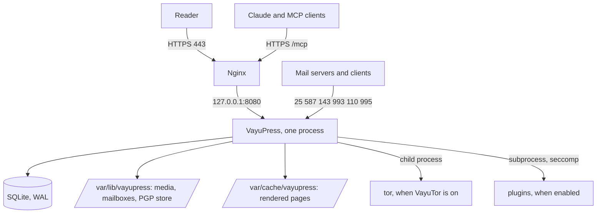
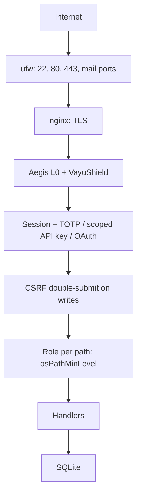

# VayuPress Architecture

**Last reviewed:** 2026-10-16, against VayuPress 3.18.7

## Purpose

VayuPress is one Go binary and one SQLite database that together serve a
website, a blog, a mail server, encrypted chat, Tor onion services, an API, an
MCP server and the console that runs them. It is built for a single modest
VPS — 8 GB RAM, 4 vCPU, 50 GB NVMe — and is proven at 234,727 posts and
fourteen sites on one Contabo VPS 10 (johal.in, October 2026).

Every decision behind this shape is recorded in the [ADR registry](adr/).

## System context



Nginx terminates TLS and proxies every page to the application; it serves
nothing from the page cache itself (the only files it serves directly are ACME
challenges). The application listens on loopback. The mail server listens on
the public mail ports directly — systemd grants the non-root service
`CAP_NET_BIND_SERVICE` for that and nothing else.

## A request, in order

Every HTTP request passes the same chain (`cmd/vayupress/routes.go`):

1. **Core** — a request ID; the client address, honouring forwarding headers
   only from a configured proxy (`realIPMiddleware`); a structured log line;
   security headers (CSP with a per-request nonce, HSTS, `X-Frame-Options`);
   compression for clients that ask.
2. **Maintenance** — the maintenance page for visitors when the operator has
   taken the site down; the console, health and the signed-in operator pass.
3. **Crawler block** — when the operator has hidden the site from indexers.
4. **Tor onion** — maps an `.onion` host to the domain it serves, and adds
   `Onion-Location` on clearnet responses.
5. **Domain** — resolves which hosted site owns the `Host` (VayuDomains), then
   that site's CSP.
6. **Redirects** — operator-defined 301/302s.
7. **Aegis L0, the sovereignty lane** — caps public concurrency so the console
   keeps headroom under load, before any classification or database work.
8. **VayuShield** — classifies the request: fair-shed, reputation, inspection
   rules, challenges.
9. **Release mirror, CORS**, then the router.

## Pages

Public pages — home, posts, topics, for every domain — are rendered from the
database and kept on disk (`internal/render`).

- **Kept and invalidated.** A page is fresh until a write purges it or a
  renderer or settings change advances the staleness cutoff
  (`render.CacheEntryFresh`). Edits purge their own pages; a theme change
  stales them all.
- **Never waiting on a re-render.** A stale page is served at once and redrawn
  off the request path, single-flighted and bounded (`cache_swr.go`). The
  operator who made it stale is the exception, and sees the new page.
- **Cold renders are capped.** Pages not on disk take a render slot
  (`admitColdRender`); past the cap a visitor is asked to retry rather than
  queue the server into the ground.
- **Listings read cards, not bodies.** A listing chooses its posts from a
  covering index, then reads each post's card (title, excerpt, picture) from
  `article_cards`. The warmer builds missing cards ahead of visitors, so a cold
  topic page reads two hundred small rows instead of two hundred post bodies.
- **The warmer.** Every five minutes it builds missing cards, then rebuilds
  missing or stale pages newest first, at the pace the host can spare
  (`cachewarm.go`, `internal/pace`).
- **Browsers revalidate.** Pages are sent `Cache-Control: no-cache` with
  `Last-Modified`; an unchanged page answers `304`.
- **One switch.** Settings › Advanced › Page cache turns keeping pages off; feeds,
  sitemaps and `robots.txt` are kept regardless.

The theme decides how a page is drawn. **Halcyon** is the default
(`internal/render/halcyon*`, ADR-0166): its own layouts for home, posts, topics
and search, one stylesheet (9.4 KB gzipped) and one script (3.8 KB), fonts
served from the origin. Every post carries one structured-data graph built by
the server, whatever the theme.

## Writes

```mermaid
graph LR
    API[Editor / API / MCP] --> Jobs[(write_jobs)]
    Jobs --> W[Workers, WORKER_COUNT, default 3]
    W --> Articles[(articles, article_tags)]
    W --> Events[Event bus]
    Events --> Search[VayuFind index]
    Events --> Purge[Page purge]
    Events --> Outbox[(outbox) → relay]
```

- A write is persisted as a job in SQLite before any worker takes it
  (`internal/queue`), so a crash resumes it.
- A failed job is retried three times with backoff (10 s, 20 s, 40 s, capped at
  five minutes) and then moved to the **dead letter**, where the console's
  replay explorer can run it again.
- Each write publishes a domain event (`internal/events`). Subscribers keep
  the search index current, purge the post's pages and announce it to
  IndexNow (`registerEventHandlers`); events that must survive a crash are
  committed with the write itself and delivered by the outbox relay
  (`internal/outbox`). A periodic reconciler heals any search drift.
- Search is **VayuFind**, built in (`internal/search`, ADR-0101): no external
  service, maintained by those events, its index snapshotted to disk so a
  restart restores rather than rebuilds.

## The database

One SQLite file in WAL mode (`internal/db`).

- **One writer.** The write connection is limited to one; readers use a
  separate pool, and the console's heavy reads a pool of their own.
- **Migrations** are numbered SQL files compiled into the binary; each applied
  migration's SHA-256 is recorded, and the server will not start if one
  differs (ADR-0034).
- **Covering indexes** serve the hot listings: `idx_articles_feed` for home,
  `idx_article_tags_live` for topics.
- **Append-only audit log**, enforced by triggers.

## Media

Uploads are stored content-addressed under `/var/lib/vayupress/media`, checked
by magic number, and downscaled with the standard library's codecs only
(`internal/imageproc` — no libvips, no CGO). An image that declares dimensions
beyond the pixel budget is refused before it is decoded.

## Control of the install itself

- **Modes** (`internal/mode`): normal, degraded, read-only, recovery,
  maintenance, quarantined — shown on every console page, journalled, and
  restored after a restart. What each refuses is in
  [architecture/system-modes.md](architecture/system-modes.md).
- **Faults** (`internal/fault`) escalate to a mode when they repeat: WAL write
  faults and migration faults to read-only, plugin faults to quarantined,
  outbox failures to degraded.
- **The pacer** (`internal/pace`) is asked before each step of background work
  — backups, the warmer, card building, restore drills — and sizes it by how
  busy the host is.

## The parts, by package

| Area | Packages | ADR |
|------|----------|-----|
| Rendering, themes, Halcyon | `internal/render`, `internal/theme`, `internal/blockrender`, `internal/markdown`, `internal/diagram` | ADR-0086, ADR-0166 |
| Search | `internal/search` (VayuFind) | ADR-0101 |
| Bot protection | `internal/vayushield`, `internal/shieldaudit` | ADR-0111 |
| Analytics | `internal/vayuanalytics` | ADR-0097 |
| Mail, PGP, chat | `internal/vayuos/mail`, `internal/vayuos/pgp`, `internal/vayuos/vayutalk` | ADR-0077, ADR-0131, ADR-0144 |
| Tor | `internal/vayuos/vayutor`, `internal/vayuos/torspace` | ADR-0138, ADR-0141, ADR-0143 |
| Sites | `internal/domain`, `internal/bizsite`, `internal/customsite`, `internal/sitedoc`, `internal/docsite` | ADR-0152–0154, ADR-0161 |
| API, keys, MCP, OAuth | `internal/api`, `internal/apikeys`, `internal/mcp`, `internal/oauth`, `internal/vcb` | ADR-0134, ADR-0135, ADR-0139 |
| Members, payments | `internal/members`, `internal/payments`, `internal/newsletter` | ADR-0087 |
| Automation, observation | `internal/vayuflow`, `internal/vayuveil` | ADR-0150, ADR-0151 |
| Backups, updates | `internal/backup`, `internal/vayukeep`, `internal/update`, `internal/sqlitecopy` | ADR-0145 |
| Plugins | `internal/plugins`, `internal/sandbox` | ADR-0057 |
| Kernel | `internal/db`, `internal/queue`, `internal/outbox`, `internal/events`, `internal/mode`, `internal/fault`, `internal/pace`, `internal/metrics`, `internal/logging` | ADR-0033–0035 |
| Console | `cmd/vayupress` (`admin_os_*.go`), `internal/ui` | ADR-0068 |

Which package may import which is a test, not a convention
(`internal/archcheck`).

## Security architecture



Entry points, assets and every mitigation's mechanism are in the
[threat model](THREAT-MODEL.md) and [attack surfaces](security/attack-surfaces.md).

## Budgets that are checked

| What | Budget | Where it is enforced |
|------|--------|----------------------|
| Binary size | 45 MB gzipped (60 MB as shipped at 3.18.7) | `make check-size` |
| Halcyon stylesheet, script | 9.4 KB, 3.8 KB gzipped (recorded at 3.18.0) | Halcyon's byte budget tests |
| Lighthouse | Home, a post and four console pages | `lighthouse.yml` |
| Console design | Every value on the token scale | The design lint in the browser tests |
| Reproducibility | Two cold builds byte-identical | `scripts/reproducible-build.sh` |

## Direct dependencies

| Module | Role |
|--------|------|
| `github.com/go-chi/chi/v5` | HTTP router |
| `github.com/mattn/go-sqlite3` | SQLite (linked statically, CGO) |
| `github.com/microcosm-cc/bluemonday` | HTML sanitising (posts, comments, SVG diagrams) |
| `github.com/yuin/goldmark` | Markdown |
| `github.com/alecthomas/chroma/v2` | Code highlighting |
| `github.com/ProtonMail/go-crypto` | OpenPGP |
| `github.com/emersion/go-msgauth`, `blitiri.com.ar/go/spf` | DKIM, DMARC, SPF |
| `github.com/emersion/go-webdav`, `go-ical`, `go-vcard` | Contacts and calendars over DAV |
| `github.com/digitorus/pkcs7`, `software.sslmate.com/src/go-pkcs12` | S/MIME |
| `github.com/sigstore/sigstore-go` | Verifying signed releases |
| `gitlab.torproject.org/…/goptlib`, `…/lyrebird` | Tor pluggable transports (obfs4) |
| `github.com/phuslu/iploc` | The embedded country table |
| `github.com/graphql-go/graphql` | The GraphQL API |
| `github.com/parquet-go/parquet-go` | Analytics export |
| `github.com/rs/cors` | CORS |
| `rsc.io/qr` | QR codes for TOTP enrolment and mail setup |
| `golang.org/x/crypto`, `x/net`, `x/sys`, `x/text` | Go's extended standard library |

Vendored browser assets, served from the origin and embedded in the binary
(`//go:embed static`, mirrored to `STATIC_DIR` on boot, ADR-0099): htmx (0BSD)
and Alpine.js's CSP build for the console, DOMPurify for previews, and Pico CSS
for the classic public theme. Licences are in [NOTICE](../NOTICE).

No frontend framework and no build step: the console is server-rendered Go with
htmx ([ADR-0107](adr/ADR-0107-self-hosted-htmx.md)).
